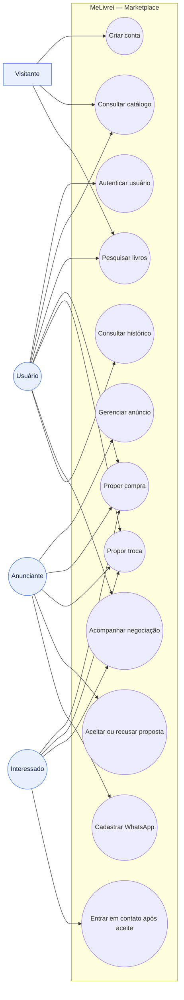

# Diagrama de casos de uso — MeLivrei

## Observações

- O diagrama representa o escopo de venda e troca definido no PRD.
- Os papéis `Anunciante` e `Interessado` representam funções que um mesmo usuário pode exercer em diferentes negociações.

- UC-08 foi retirado do escopo. O aceite em UC-11 libera UC-13 somente ao interessado participante; conversa e pagamentos ocorrem externamente.
