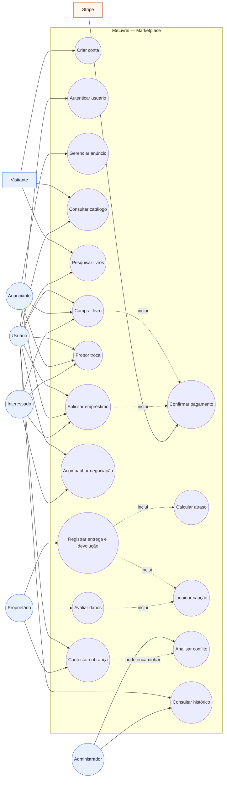

## Observações

- O diagrama representa o escopo funcional definido no PRD.
- `inclui` representa um comportamento necessário dentro do fluxo principal.
- `pode encaminhar` representa um caminho alternativo: uma contestação pode ser encaminhada para análise administrativa.
- Os papéis `Anunciante`, `Interessado` e `Proprietário` representam funções que um mesmo usuário pode exercer em diferentes negociações.
- O Stripe é um sistema externo responsável pela confirmação de pagamentos; os dados completos do cartão não pertencem ao sistema.

