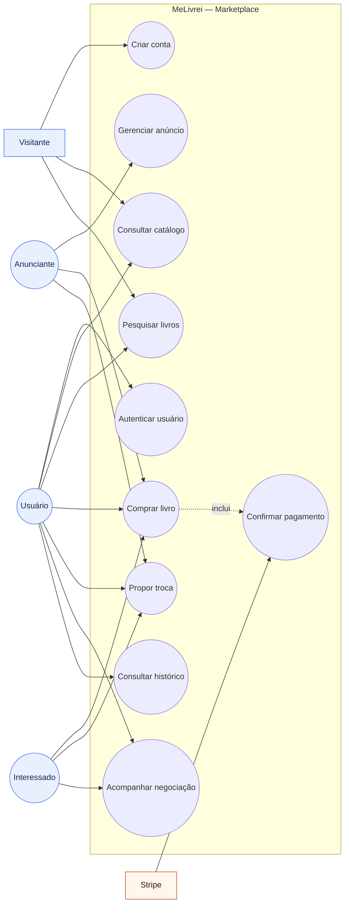

# Diagrama de casos de uso — MeLivrei

## Observações

- O diagrama representa o escopo de venda e troca definido no PRD.
- `inclui` representa um comportamento necessário dentro do fluxo principal.
- Os papéis `Anunciante` e `Interessado` representam funções que um mesmo usuário pode exercer em diferentes negociações.
- O Stripe é o sistema externo responsável pela confirmação de pagamentos; os dados completos do cartão não pertencem ao sistema.
